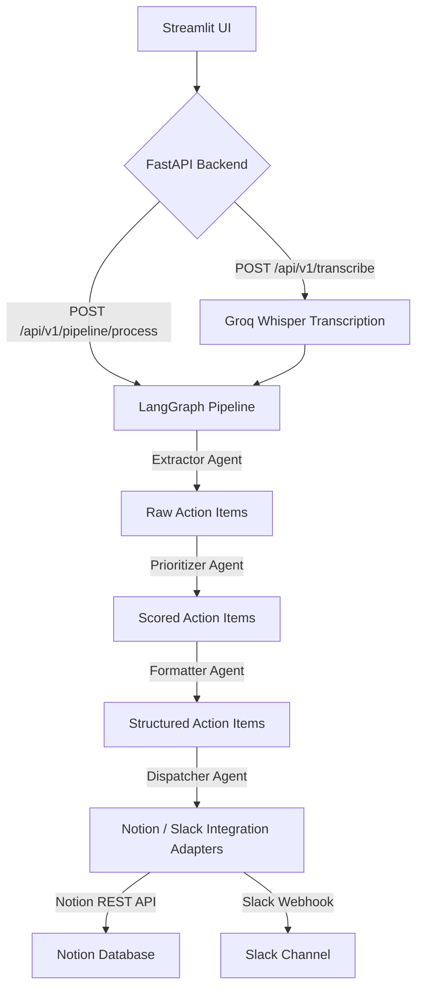

<div align="center">

# 📝 ActionScribe

### *AI-Powered Meeting-to-Action Pipeline*

<p>

  
  
  
  
  
  
  
  
</p> <p>
  <strong>A fully automated LangGraph agent pipeline that ingests meeting audio, transcribes it, extracts actionable tasks, scores priorities, and dispatches them directly to Notion and Slack.</strong>
</p> </div>

---

## 📋 Table of Contents

- [Overview](#-overview)

- [Key Features](#-key-features)

- [Architecture](#-architecture)

- [Tech Stack](#-tech-stack)

- [Project Structure](#-project-structure)

- [Quick Start](#-quick-start)

- [API Reference](#-api-reference)

- [Security & Integrations](#-security--integrations)

- [Screenshots](#-screenshots)

- [Contributing](#-contributing)

- [License](#-license)

---

## 🌟 Overview

**ActionScribe** is an innovative, AI-powered solution designed to streamline post-meeting workflows by automating the identification, prioritization, and distribution of action items. Leveraging a sophisticated **LangGraph** agent architecture, ActionScribe transforms raw meeting audio or transcripts into structured, actionable tasks, significantly reducing manual effort and improving team productivity.

The system integrates with project management and communication tools like Notion and Slack. It uses **Groq** for Whisper Large v3 transcription and GPT-OSS 20B task analysis. Notion and Slack are optional integrations.

---

## ✨ Key Features

| Feature | Description |
| --- | --- |
| 🎙️ **Audio & Text Ingestion** | Supports direct upload of `.mp3`/`.wav` audio recordings or pasting raw meeting transcripts for flexible input. |
| ⚡ **AI Processing** | Uses Groq Whisper Large v3 for transcription and GPT-OSS 20B for action item extraction and analysis. |
| 🧠 **Multi-Agent LangGraph Pipeline** | Orchestrates a sophisticated workflow involving Extractor, Prioritizer, Formatter, and Dispatcher agents to ensure comprehensive task management. |
| 📊 **Intelligent Priority Scoring** | Utilizes an LLM to assign a priority score (1-25) based on the urgency and business impact of each action item. |
| 🔗 **Notion Integration** | Automatically creates detailed database pages in Notion for every extracted task, facilitating organized project management. |
| 📢 **Slack Broadcasting** | Posts formatted meeting summaries and task lists to designated Slack channels, ensuring timely team communication. |
| 🌐 **Interactive Streamlit Dashboard** | Provides a user-friendly interface to monitor pipeline progress, review extracted tasks, and manage integrations on the fly. |

---

## 🏗️ Architecture



---

## 🛠️ Tech Stack

| Layer | Technology | Purpose |
| --- | --- | --- |
| **Frontend** | Streamlit | Interactive web dashboard for user input and results display. |
| **Backend** | FastAPI, Python 3.11+ | High-performance REST API server for orchestrating the pipeline. |
| **AI/LLM** | LangChain, LangGraph, Groq (GPT-OSS 20B & Whisper Large v3) | Core AI engine for transcription, extraction, prioritization, and formatting. |
| **Integrations** | Notion REST API, Slack Incoming Webhooks | Optional dispatch of action items to project management and communication platforms. |
| **Infrastructure** | Docker, Docker Compose | Containerization for easy setup, deployment, and scalability. |

---

## 📂 Project Structure

```
ActionScribe/
├── 📁 agents/                    # LangGraph agents for extraction, prioritization, formatting
│   ├── __init__.py
│   ├── extractor_agent.py       # Extracts raw action items from transcript
│   ├── formatter_agent.py       # Validates and formats action items
│   ├── graph.py                 # Defines the LangGraph workflow
│   └── prioritizer_agent.py     # Assigns urgency x impact scores
├── 📁 api/                       # FastAPI backend application
│   ├── __init__.py
│   └── main.py                  # Main FastAPI application entry point, defines endpoints
├── 📁 mcp/                       # Notion REST and Slack webhook integrations
│   ├── __init__.py
│   ├── notion_mcp.py            # Handles dispatching tasks to Notion
│   └── slack_mcp.py             # Handles dispatching summaries to Slack
├── 📁 transcriber/               # Audio transcription module
│   ├── __init__.py
│   └── whisper_api.py           # Groq Whisper cloud API client
├── 📁 ui/                        # Streamlit frontend application
│   └── app.py                   # Streamlit dashboard for user interaction
├── 📁 tests/                     # Unit and integration tests
│   ├── __init__.py
│   ├── test_api.py
│   ├── test_extractor.py
│   ├── test_graph.py
│   └── test_prioritizer.py
├── Dockerfile.backend           # Dockerfile for the FastAPI backend
├── Dockerfile.frontend          # Dockerfile for the Streamlit frontend
├── docker-compose.yml           # Docker Compose for multi-service orchestration
├── generate_sample_audio.py     # Script to generate sample audio for testing
├── README.md                    # This README file
├── requirements.txt             # Python dependencies
└── sample_meeting.mp3           # Sample audio file for demonstration
```

---

## 🚀 Quick Start

The fastest way to get ActionScribe up and running is using Docker Compose.

### Prerequisites

- [Docker Desktop](https://www.docker.com/products/docker-desktop/) installed and running.

- A **Groq API key** is required for AI analysis and transcription. Notion and Slack credentials are optional.
  - Get your Groq API key from [Groq Console](https://console.groq.com/keys).
  - Obtain Notion API key and database ID from [Notion Developers](https://developers.notion.com/).
  - Create a Slack Incoming Webhook URL from [Slack API](https://api.slack.com/apps).

### Step 1 — Clone the repository

```bash
git clone https://github.com/shubham333k/ActionScribe.git
cd ActionScribe
```

### Step 2 — Configure environment variables

Copy the example environment file and populate it with your API keys:

```bash
cp .env.example .env
```

Open `.env` and add your Groq key. Add Notion and Slack values only if you want to use those integrations:

```
GROQ_API_KEY=gsk_your_groq_api_key_here
NOTION_API_KEY=secret_your_notion_api_key_here
NOTION_DATABASE_ID=your_notion_database_id_here
SLACK_WEBHOOK_URL=https://hooks.slack.com/services/your/slack/webhook/url
```

### Step 3 — Launch with Docker Compose

```bash
docker-compose up --build
```

This will build and start both the FastAPI backend and the Streamlit frontend.

### Step 4 — Access the application

| Service | URL |
| --- | --- |
| 🌐 Streamlit UI | [http://localhost:8501](http://localhost:8501) |
| ⚙️ FastAPI Backend | [http://localhost:8000](http://localhost:8000) |
| 📖 API Swagger Docs | [http://localhost:8000/docs](http://localhost:8000/docs) |

---

## 💻 Local Development

For a faster development feedback loop, you can run each service individually.

### Backend (FastAPI)

```bash
# Run these commands from the repository root.
py -3.11 -m venv .venv
# On Windows PowerShell:
.\.venv\Scripts\Activate.ps1
# On macOS / Linux:
source .venv/bin/activate

pip install -r requirements.txt

# Start the dev server with hot-reload
python -m uvicorn api.main:app --reload --port 8000
```

### Frontend (Streamlit)

```bash
# In a second terminal, from the repository root, activate the same .venv.
# On Windows PowerShell:
.\.venv\Scripts\Activate.ps1
# On macOS / Linux:
source .venv/bin/activate

python -m streamlit run ui/app.py
```

The Streamlit frontend will be available at [**http://localhost:8501**](http://localhost:8501). It connects to the backend automatically via the `BACKEND_URL` environment variable.


---

## 📡 API Reference

Key endpoints exposed by the FastAPI backend:

| Method | Endpoint | Description | Auth Required |
| --- | --- | --- | --- |
| `GET` | `/api/health` | Service health check. | No |
| `POST` | `/api/v1/transcribe` | Transcribe an audio file to text using Groq Whisper API (cloud). | No |
| `POST` | `/api/v1/pipeline/process` | Full pipeline: Audio or Transcript → Action Items → Notion + Slack. | No |
| `GET` | `/docs` | Interactive Swagger UI for API documentation. | No |

---

## 🔒 Security & Integrations

ActionScribe is designed with robust integrations and considerations for secure operation:

- **🔑 API Key Management** — All sensitive API keys (Groq, Notion) are loaded from environment variables, ensuring they are never hardcoded and can be securely managed.

- **🔗 Notion Integration** — Seamlessly creates new database items in your specified Notion database, allowing for centralized task tracking.

- **💬 Slack Integration** — Posts concise summaries and action item lists to designated Slack channels, keeping your team informed.

- **🛡️ CORS Protection** — Configurable CORS middleware in FastAPI allows for controlled access to the API endpoints.

---

## 📸 Screenshots

Here are some screenshots of the ActionScribe dashboard in action:

<div align="center">

  <p><i>The main dashboard showing audio upload, transcript input, and extracted action items.</i></p>
</div>

---

## 🤝 Contributing

Contributions are welcome! Please follow these steps:

1. Fork the repository

1. Create a feature branch: `git checkout -b feature/your-feature-name`

1. Commit your changes: `git commit -m 'feat: Add your feature'`

1. Push to the branch: `git push origin feature/your-feature-name`

1. Open a Pull Request

Please ensure your code passes the existing test suite:

```bash
# For backend tests
cd ActionScribe/tests
pytest -v
```

---

## 📄 License

This project is licensed under the **MIT License**.
