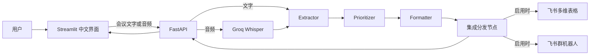
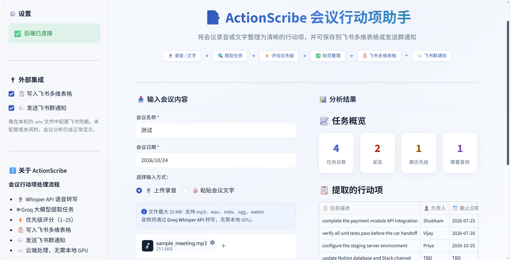
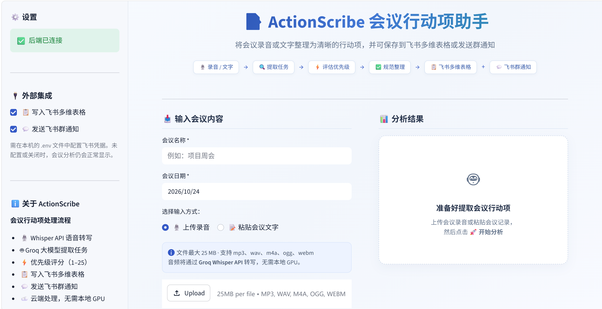

# ActionScribe｜会议行动项助手

<p align="center">
  <strong>把会议录音和文字整理成可执行的行动项</strong><br>
  支持任务提取、优先级评估、飞书多维表格和飞书群通知
</p>

<p align="center">
  
  
  
  
  
</p>

ActionScribe 是一个中文会议行动项助手。粘贴会议记录或上传录音后，系统会转写音频、提取任务、评估优先级并展示结构化结果。你可以选择把任务写入飞书多维表格，或发送到飞书群机器人。

## 目录

- [功能](#功能)
- [系统架构](#系统架构)
- [技术栈](#技术栈)
- [项目结构](#项目结构)
- [快速开始](#快速开始)
- [本地开发](#本地开发)
- [API 接口](#api-接口)
- [飞书集成与安全](#飞书集成与安全)
- [项目截图](#项目截图)
- [测试](#测试)
- [许可证](#许可证)

## 功能

- **会议内容输入**：粘贴会议文字，或上传 MP3、WAV、M4A、OGG、WEBM 音频，单个文件最大 25 MB。
- **语音转写**：通过 Groq Whisper Large v3 云端转写，无需本地 GPU。
- **行动项提取**：使用 Groq 聊天模型识别任务内容、负责人和截止日期。
- **优先级评估**：结合紧急度和影响度计算 1–25 分，并标注优先级和复核状态。
- **结果查看与导出**：在中文 Streamlit 页面查看任务，并可下载 JSON。
- **按会议创建飞书数据表**：会议分析成功且启用多维表格写入时，在配置的 Base 内新建一张表，再写入本次任务；不会覆盖或删除旧表和记录。
- **飞书群通知**：将会议名称、日期和任务摘要发送到自定义机器人。多维表格与群通知可以分别启用，也可以同时启用。

## 系统架构



音频先由 Whisper 转成文字；文字随后进入 LangGraph 工作流。Extractor 提取任务，Prioritizer 评估优先级，Formatter 校验并规范字段，最后由分发节点按页面开关调用飞书。启用两个集成时，先创建并写入新数据表，再发送群消息；群消息仅在本次表格写入完整成功且链接有效时附上该表链接。

## 技术栈

| 模块 | 技术 |
| --- | --- |
| 前端 | Streamlit、pandas |
| 后端 | FastAPI、Uvicorn、Pydantic |
| 工作流 | LangGraph、LangChain |
| 语言模型 | Groq API，默认 `openai/gpt-oss-20b` |
| 语音转写 | Groq Whisper `whisper-large-v3` |
| 外部集成 | 飞书多维表格 REST API、飞书自定义机器人 Webhook |

## 项目结构

```text
ActionScribe/
├── agents/                 # LangGraph 状态、节点及任务处理 Agent
├── api/main.py             # FastAPI 应用和 HTTP 接口
├── integrations/feishu.py  # 飞书多维表格与群机器人
├── transcriber/            # Groq Whisper 音频转写
├── ui/app.py               # Streamlit 中文前端
├── tests/                  # API、Agent、工作流和集成测试
├── assets/                 # README 项目截图
├── sample_meeting.mp3      # 示例会议录音
├── .env.example            # 本地环境变量模板
├── REPRODUCTION.md         # 安装、架构、联调和复现记录
└── requirements.txt        # Python 依赖
```

## 快速开始

### 环境要求

- Windows 10/11
- Python 3.11
- Git
- Groq API Key，用于文字分析和音频转写
- 飞书应用与群机器人为可选项；未启用时仍可完成分析并查看结果

Groq API 请求受你的 Groq 账户方案和用量限制。请在其官方控制台查看适用的费用与额度。

### 安装依赖

在 PowerShell 中执行：

```powershell
git clone https://github.com/Liuzilu0913/ActionScribe.git
Set-Location ActionScribe

py -3.11 -m venv .venv
.\.venv\Scripts\Activate.ps1
python -m pip install -r requirements.txt
Copy-Item .env.example .env
notepad .env
```

在 `.env` 中配置 Groq Key：

```dotenv
GROQ_API_KEY=填写你自己的Groq_API_Key
GROQ_CHAT_MODEL=openai/gpt-oss-20b
```

`.env` 只用于本机配置，已列入 `.gitignore`。不要把 API Key、App Secret 或机器人 Webhook 提交到 Git。

### 启动服务

打开两个 PowerShell 窗口，并确保都位于项目根目录。

窗口一启动后端：

```powershell
.\.venv\Scripts\Activate.ps1
uvicorn api.main:app --reload --host 127.0.0.1 --port 8000
```

窗口二启动前端：

```powershell
.\.venv\Scripts\Activate.ps1
streamlit run ui/app.py --server.address 127.0.0.1 --server.port 8501
```

打开 [http://localhost:8501](http://localhost:8501)。后端健康状态位于 [http://localhost:8000/api/health](http://localhost:8000/api/health)，交互式接口文档位于 [http://localhost:8000/docs](http://localhost:8000/docs)。

仓库也包含 Docker Compose 配置；项目当前的本地复现使用 Windows Python 虚拟环境，Docker Compose 启动路径尚未验证。

## 本地开发

### 使用示例会议记录

1. 打开前端，选择“粘贴会议文字”。
2. 使用“填入示例会议记录”，或粘贴自己的会议纪要。
3. 如果不启用飞书集成，可以不填会议名称和日期。
4. 点击“开始分析”，在右侧查看任务、负责人、截止日期和优先级。

上传录音时，选择支持的音频文件后点击“开始分析”。前端会把录音交给 FastAPI，后端调用 Groq Whisper 转写，然后将转写内容送入同一条任务分析工作流。

### LangGraph 工作流

工作流的共享 `PipelineState` 保存会议文字、会议信息、集成开关、各节点处理结果和错误。节点顺序为：

```text
START → extractor → prioritizer → formatter → integration_dispatcher → END
```

- **State**：在各节点之间传递文字、任务、评分和集成结果。
- **Node**：Extractor 提取原始待办；Prioritizer 计算紧急度、影响度和优先级；Formatter 将字段整理为统一结构；Dispatcher 执行已启用的飞书集成。
- **Edge**：连接节点并规定执行顺序。当前工作流按固定顺序运行，分发节点根据开关决定是否调用飞书。

## API 接口

| 方法 | 路径 | 用途 |
| --- | --- | --- |
| `GET` | `/api/health` | 检查后端服务状态 |
| `POST` | `/api/v1/transcribe` | 上传音频并返回转写文字 |
| `POST` | `/api/v1/pipeline/process` | 提交文字或音频，运行完整工作流并返回任务与集成状态 |
| `GET` | `/docs` | 打开 FastAPI Swagger 文档 |

完整分析接口接收 `raw_transcript` 或 `audio_file`，并可接收 `send_to_bitable`、`send_to_feishu_chat`、`meeting_name` 和 `meeting_date`。启用任一飞书集成时，会议名称和日期均为必填；两项都关闭时可留空。日期格式为 `YYYY-MM-DD`。前端和后端均会在调用模型或飞书之前校验这些输入。

## 飞书集成与安全

### 飞书多维表格

在飞书开放平台创建应用并授予目标 Base 的访问权限。将下列配置写入本机 `.env`：

```dotenv
FEISHU_APP_ID=
FEISHU_APP_SECRET=
FEISHU_BITABLE_APP_TOKEN=
```

`FEISHU_BITABLE_APP_TOKEN` 指向多维表格 Base。启用“写入飞书多维表格”并成功完成会议分析后，每次用户主动提交都会在该 Base 内创建新数据表，名称为 `YYYY-MM-DD_会议名称`。页面自动重新运行不会触发建表。如果名称已存在，程序会查询当前表名并在最大数字后缀上递增，例如 `_1`、`_2`。表和字段创建成功后，程序使用新接口返回的 `table_id` 写入本次任务。已有数据表和记录不会被覆盖或删除。

每张新表按 `FEISHU_FIELD_*` 环境变量创建字段；未自定义时使用 `.env.example` 的中文默认列名。字段包括任务、负责人、截止日期、优先级、评分、复核状态和原文摘录。会议名称和日期与群通知共用同一组输入。页面显示写入状态和实际写入数量；表名可在飞书 Base 左侧数据表列表中查看。

应用需要多维表格管理权限（`bitable:app`）以及目标 Base 的访问权限。若权限需要审核，应在飞书开放平台发布包含最新权限的应用版本并等待审核生效。

### 飞书群机器人

在群聊中添加自定义机器人，并在本机 `.env` 配置：

```dotenv
FEISHU_BOT_WEBHOOK_URL=
FEISHU_BOT_SECRET=
FEISHU_BOT_KEYWORD=
```

Webhook 必填。若机器人启用了签名校验，配置对应的 `FEISHU_BOT_SECRET`；若设置了关键词校验，配置 `FEISHU_BOT_KEYWORD`。机器人会收到会议名称、日期、任务数和任务摘要。仅启用群通知时不会创建数据表，也不会附加旧表链接。两个集成都启用时，先处理本次新表；写入完整成功且有有效链接时，消息附上该表链接。写入失败时仍会发送摘要，并说明实际写入结果。

所有凭据只应保存在本机 `.env`。请勿将 `.env`、API Key、App Secret 或 Webhook 地址放入截图、README、源码或提交记录。

## 项目截图

### 分析结果与飞书集成状态



### 初始页面



## 测试

运行项目测试：

```powershell
pytest -q
```

当前复现记录中，自动化测试为 36 项通过。真实 Groq 与飞书联调范围、Mock 覆盖内容、权限要求和未验证边界请查看 [REPRODUCTION.md](REPRODUCTION.md)。Mock 测试不会调用 Groq 或发送飞书消息；真实服务验证情况以复现记录为准。

## 许可证

本项目采用 MIT License，详情见 [LICENSE](LICENSE)。
