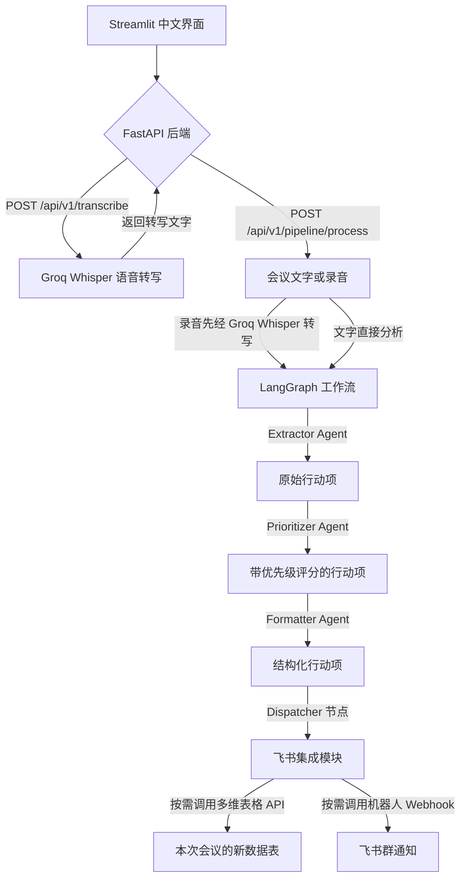

<div align="center">

# 📝 ActionScribe

### *AI 驱动的会议行动项处理工作流*

<p>
  
  
  
  
  
  
  
  
  
</p>
<p>
  <strong>基于 LangGraph 的自动化 Agent 工作流：接收会议录音或文字，完成语音转写、行动项提取和优先级评分，并可将任务写入飞书多维表格、发送到飞书群。</strong>
</p>
</div>

---

## 📋 目录

- [项目概述](#overview)

- [核心功能](#key-features)

- [系统架构](#architecture)

- [技术栈](#tech-stack)

- [项目结构](#project-structure)

- [快速开始](#quick-start)

- [本地开发](#local-development)

- [API 参考](#api-reference)

- [安全与集成](#security-integrations)

- [项目截图](#screenshots)

- [参与贡献](#contributing)

- [许可证](#license)

---

<a id="overview"></a>

## 🌟 项目概述

**ActionScribe** 是一款 AI 驱动的会议行动项助手，通过自动识别、排序和分发待办任务，简化会后工作。借助 **LangGraph** Agent 架构，ActionScribe 将会议录音或文字记录转换为结构化、可执行的任务，减少人工整理工作，帮助团队推进会议决策。

系统集成**飞书多维表格**和**飞书群机器人**，支持按会议创建数据表、保存行动项并发送任务摘要。语音转写使用 **Groq** 提供的 **Whisper Large v3**，任务分析默认使用 **openai/gpt-oss-20b**，可通过 `GROQ_CHAT_MODEL` 配置。中文界面提供任务概览、负责人、截止日期、优先级和复核状态；未启用外部集成时，也能独立完成会议分析并下载 JSON。

---

<a id="key-features"></a>

## ✨ 核心功能

| 功能 | 说明 |
| --- | --- |
| 🎙️ **音频与文字输入** | 支持上传 `.mp3`、`.wav`、`.m4a`、`.ogg`、`.webm` 会议录音，或直接粘贴会议文字；单个音频文件最大 25 MB。 |
| ⚡ **Groq 云端 AI 处理** | 通过 Groq 调用 Whisper Large v3 转写录音，并使用 `openai/gpt-oss-20b` 分析会议文字，无需本地 GPU。 |
| 🧠 **多 Agent LangGraph 工作流** | 按顺序组织 Extractor、Prioritizer、Formatter 和 Dispatcher 节点，完成任务提取、评分、字段整理与集成分发。 |
| 📊 **智能优先级评分** | 根据任务紧急度和业务影响度计算 1–25 分的优先级评分，并标记优先级和需要人工复核的任务。 |
| 🔗 **飞书多维表格集成** | 在配置的 Base 内为本次会议新建数据表，自动创建字段并写入任务；同名表使用递增后缀，保留已有表和记录。 |
| 📢 **飞书群通知** | 向指定群机器人发送会议名称、日期和任务摘要；本次多维表格写入完整成功且链接有效时，可附上新表链接。 |
| 🌐 **交互式 Streamlit 面板** | 提供中文输入与结果界面、后端连接状态、任务概览、JSON 下载，以及可分别开启的飞书集成选项。 |

---

<a id="architecture"></a>

## 🏗️ 系统架构



工作流通过共享的 `PipelineState` 传递会议文字、会议信息、任务、评分和集成结果，节点按 `extractor → prioritizer → formatter → integration_dispatcher` 的固定顺序执行。单独调用转写接口只返回文字；完整分析接口会将文字送入工作流。关闭两个飞书集成时，仍返回分析结果；同时开启时，先写入新表，再发送群通知。

---

<a id="tech-stack"></a>

## 🛠️ 技术栈

| 层级 | 技术 | 用途 |
| --- | --- | --- |
| **前端** | Streamlit、pandas | 提供中文交互面板，接收会议内容并展示任务、评分与集成结果。 |
| **后端** | FastAPI、Python 3.11、Uvicorn、Pydantic | 提供 REST API，校验输入并调度会议处理工作流。 |
| **AI / LLM** | LangChain、LangGraph、Groq（`openai/gpt-oss-20b` 与 Whisper Large v3） | 完成语音转写、行动项提取、优先级评估和结构化整理。 |
| **外部集成** | 飞书多维表格 REST API、飞书自定义机器人 Webhook | 按会议创建数据表、保存行动项并发送群通知。 |
| **基础设施** | Docker、Docker Compose、Python 虚拟环境 | 提供容器配置及本地开发环境；当前本地运行采用 Windows Python 虚拟环境。 |

---

<a id="project-structure"></a>

## 📂 项目结构

```text
ActionScribe/
├── 📁 agents/                    # LangGraph 任务提取、评分和格式化 Agent
│   ├── __init__.py
│   ├── extractor_agent.py       # 从会议文字提取原始行动项
│   ├── formatter_agent.py       # 校验并规范行动项字段
│   ├── graph.py                 # 定义共享状态、工作流和集成分发节点
│   └── prioritizer_agent.py     # 计算紧急度 × 影响度评分
├── 📁 api/                       # FastAPI 后端应用
│   ├── __init__.py
│   └── main.py                  # 应用入口、HTTP 接口和输入校验
├── 📁 integrations/              # 外部平台集成
│   ├── __init__.py
│   └── feishu.py                # 飞书新表创建、任务写入和群通知
├── 📁 transcriber/               # 音频转写模块
│   ├── __init__.py
│   └── whisper_api.py           # 通过 Groq 调用 Whisper API
├── 📁 ui/                        # Streamlit 前端应用
│   └── app.py                   # 中文会议输入、结果与集成设置界面
├── 📁 tests/                     # 单元测试与集成测试
│   ├── __init__.py
│   ├── test_api.py
│   ├── test_extractor.py
│   ├── test_graph.py
│   ├── test_integrations.py
│   └── test_prioritizer.py
├── 📁 assets/                    # 项目截图
│   ├── actionscribe-analysis.png
│   └── actionscribe-empty-state.png
├── .env.example                  # 环境变量配置模板
├── Dockerfile.backend            # FastAPI 后端容器配置
├── Dockerfile.frontend           # Streamlit 前端容器配置
├── docker-compose.yml            # 多服务容器编排配置
├── generate_sample_audio.py      # 测试音频生成脚本
├── LICENSE                       # MIT 许可证
├── README.md                     # 项目说明
├── REPRODUCTION.md               # 环境配置、架构和实际验证记录
├── requirements.txt              # Python 依赖
└── sample_meeting.mp3             # 演示用会议录音
```

---

<a id="quick-start"></a>

## 🚀 快速开始

仓库提供 Docker Compose 配置，可同时启动 FastAPI 后端和 Streamlit 前端。当前 Windows 环境使用 Python 虚拟环境运行，步骤见[本地开发](#local-development)；Docker Compose 路径尚未完成运行验证。

### 环境要求

- 使用容器启动时，安装并启动 [Docker Desktop](https://www.docker.com/products/docker-desktop/)。

- 准备 **Groq API Key**；飞书应用和机器人配置为可选项。
  - 在 [Groq Console](https://console.groq.com/keys) 创建 API Key。
  - 需要写入多维表格时，在[飞书开放平台](https://open.feishu.cn/)创建应用，配置权限并授予目标 Base 访问权限。
  - 需要群通知时，在飞书群中添加自定义机器人，获取 Webhook，并按机器人的安全设置配置签名密钥或关键词。

### 第 1 步 — 克隆仓库

```bash
git clone https://github.com/Liuzilu0913/ActionScribe.git
cd ActionScribe
```

### 第 2 步 — 配置环境变量

复制环境变量模板，并填写自己的凭据：

```powershell
# Windows PowerShell
Copy-Item .env.example .env
```

```bash
# macOS / Linux
cp .env.example .env
```

打开 `.env`，按需填写：

```dotenv
# 必填：会议分析与语音转写
GROQ_API_KEY=填写你的_Groq_API_Key
GROQ_CHAT_MODEL=openai/gpt-oss-20b

# 可选：飞书多维表格
FEISHU_APP_ID=
FEISHU_APP_SECRET=
FEISHU_BITABLE_APP_TOKEN=

# 可选：飞书群机器人
FEISHU_BOT_WEBHOOK_URL=
FEISHU_BOT_SECRET=
FEISHU_BOT_KEYWORD=

# 本地前端连接后端的地址
BACKEND_URL=http://127.0.0.1:8000
```

仅体验会议分析时，填写 Groq 配置并在页面关闭两个飞书集成即可。完整字段映射和其他配置见 [`.env.example`](.env.example)。

### 第 3 步 — 使用 Docker Compose 启动

```bash
docker compose up --build
```

该命令会构建并启动 FastAPI 后端和 Streamlit 前端。容器内前端通过 Compose 配置的 `BACKEND_URL=http://backend:8000` 连接后端。

### 第 4 步 — 访问应用

| 服务 | URL |
| --- | --- |
| 🌐 Streamlit 界面 | [http://localhost:8501](http://localhost:8501) |
| ⚙️ FastAPI 后端健康检查 | [http://localhost:8000/api/health](http://localhost:8000/api/health) |
| 📖 API Swagger 文档 | [http://localhost:8000/docs](http://localhost:8000/docs) |

---

<a id="local-development"></a>

## 💻 本地开发

开发时可分别运行后端和前端。以下命令均从项目根目录执行，两个服务共用同一个 Python 虚拟环境。

### 后端（FastAPI）

```powershell
# Windows PowerShell：创建并激活 Python 3.11 虚拟环境
py -3.11 -m venv .venv
.\.venv\Scripts\Activate.ps1

# 安装依赖；先按上文配置根目录的 .env
python -m pip install -r requirements.txt

# 启动支持热重载的后端服务
uvicorn api.main:app --reload --host 127.0.0.1 --port 8000
```

macOS / Linux 可用 `python3.11 -m venv .venv` 创建环境，再用 `source .venv/bin/activate` 激活，其余安装与启动命令相同。

### 前端（Streamlit）

打开第二个终端，进入项目根目录：

```powershell
# Windows PowerShell：激活已创建的虚拟环境
.\.venv\Scripts\Activate.ps1

# macOS / Linux 使用：source .venv/bin/activate

# 启动前端
streamlit run ui/app.py --server.address 127.0.0.1 --server.port 8501
```

前端地址为 [**http://localhost:8501**](http://localhost:8501)，通过 `BACKEND_URL` 环境变量连接后端。进入页面后，可粘贴会议文字或上传录音，点击“开始分析”查看结果，并下载 JSON。启用任一飞书集成时，须填写会议名称和日期；关闭两个集成时可留空。

---

<a id="api-reference"></a>

## 📡 API 参考

FastAPI 后端提供以下主要接口：

| 方法 | 路径 | 说明 | 是否需要接口鉴权 |
| --- | --- | --- | --- |
| `GET` | `/api/health` | 检查服务状态并返回版本信息。 | 否 |
| `POST` | `/api/v1/transcribe` | 通过 Groq Whisper 云端 API 将上传的录音转成文字。 | 否 |
| `POST` | `/api/v1/pipeline/process` | 完整工作流：录音或文字 → 行动项 → 可选的飞书多维表格与群通知。 | 否 |
| `GET` | `/docs` | 查看交互式 Swagger API 文档。 | 否 |

完整分析接口接收 `multipart/form-data`，使用 `raw_transcript` 或 `audio_file` 提交会议内容；通过 `send_to_bitable` 和 `send_to_feishu_chat` 分别控制两个集成。启用任一集成时，`meeting_name` 和 `meeting_date` 必填，日期格式为 `YYYY-MM-DD`。前后端会在调用模型或飞书之前校验会议信息。具体参数和响应结构见 `/docs`。

---

<a id="security-integrations"></a>

## 🔒 安全与集成

ActionScribe 通过环境变量管理凭据，并提供可独立启用的外部集成：

- **🔑 API Key 管理** — Groq API Key、飞书 App Secret 和机器人 Webhook 从本机 `.env` 加载。`.env` 已列入 `.gitignore`，凭据不应写入源码、截图或提交记录。

- **🔗 飞书多维表格集成** — 配置 `FEISHU_APP_ID`、`FEISHU_APP_SECRET` 和 `FEISHU_BITABLE_APP_TOKEN`，为应用授予 `bitable:app` 管理权限及目标 Base 访问权限。成功分析后，每次主动提交会在该 Base 内新建名为 `YYYY-MM-DD_会议名称` 的表，同名时在最大数字后缀上递增；页面自动重新运行不会触发建表。程序自动创建任务、负责人、截止日期、优先级、评分、复核状态和原文摘录等字段，列名可通过 `FEISHU_FIELD_*` 配置。已有表和记录会保留。

- **💬 飞书群机器人集成** — 配置 `FEISHU_BOT_WEBHOOK_URL`；启用签名或关键词校验时，分别填写 `FEISHU_BOT_SECRET`、`FEISHU_BOT_KEYWORD`。群消息包含会议名称、日期、任务数和摘要。仅启用群通知时不会建表或附上旧表链接；同时启用两个集成时，只有本次表格写入完整成功且链接有效才附上新表链接，写入失败时仍发送摘要并说明实际写入结果。

- **🛡️ CORS 配置** — FastAPI 已配置 CORS 中间件，当前开发配置允许所有来源。部署时应根据实际访问域名收紧来源配置；当前 API 接口未实现用户鉴权。

---

<a id="screenshots"></a>

## 📸 项目截图

以下为 ActionScribe 中文面板的实际项目截图：

<div align="center">
  
  <p><i>分析结果页面：左侧设置飞书集成，中间输入会议内容，右侧展示任务概览和行动项。</i></p>
  
  <p><i>初始页面：上传会议录音或粘贴会议文字，填写会议信息后开始分析。</i></p>
</div>

---

<a id="contributing"></a>

## 🤝 参与贡献

欢迎参与贡献！请按以下步骤提交修改：

1. Fork 仓库。

2. 创建功能分支：`git checkout -b feature/your-feature-name`。

3. 提交修改：`git commit -m "feat: 添加功能说明"`。

4. 推送分支：`git push origin feature/your-feature-name`。

5. 创建 Pull Request。

提交前，请在项目根目录运行现有测试：

```bash
python -m pytest tests -v
```

环境配置、模块说明、实际联调范围与验证记录见 [REPRODUCTION.md](REPRODUCTION.md)。Mock 测试和真实外部服务联调的结果分别记录。

---

<a id="license"></a>

## 📄 许可证

本项目采用 **MIT License**，详情见 [LICENSE](LICENSE)。
