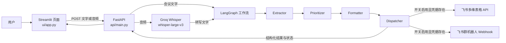

# ActionScribe 本地复现记录

复现日期：2026-10-13
仓库：`https://github.com/shubham333k/ActionScribe`
本地提交基线：`6357239`（克隆时的 `origin/main`）

## 1. 复现状态

- Windows 本地环境已就绪，使用 Python 3.11.4 和独立的 `.venv`。
- FastAPI 与 Streamlit 均已启动；健康检查、API 文档和前端页面均返回 HTTP 200。
- 自动化测试：最近一次记录为 36 项通过；Python 编译检查通过。完整结果及测试边界见第 10 节。
- Groq Key 已在本机 `.env` 配置；此前已授权并完成 Groq 真实文字分析和样例音频转写测试。本文不会读取或显示 Key。
- Notion、Slack 集成已从本项目流程中移除，改为飞书多维表格和群机器人。本次“每次新建表 + 同一元数据群通知”已完成飞书真实适配器联调；使用固定测试任务，没有通过 Streamlit 页面调用 Groq 做完整端到端重跑，详见第 10 节。
- 电脑未安装 Docker；本次采用 README 推荐的 Windows 本地 Python 环境。

## 2. 项目功能

ActionScribe 将会议录音或会议文字转换为结构化待办任务。任务包含负责人、截止日期、紧急度、影响度、优先级和原文摘录等字段。用户可以在 Streamlit 页面检查结果，并选择是否把任务写入飞书多维表格或发送到飞书群。

文本模型和语音转写均通过 Groq 云端 API 调用，不在本机运行模型，也不需要 GPU。飞书集成是可选的；未配置飞书时，任务分析和结果展示仍然可用。

## 3. 系统架构



外部服务适配器位于 `integrations/feishu.py`，直接调用飞书 REST API 和群机器人 Webhook；代码没有实现独立的 MCP 协议服务器。原版 Notion/Slack 适配器已从工作流中移除。

## 4. 模块职责与关键文件

| 文件 | 职责 |
| --- | --- |
| `ui/app.py` | Streamlit 页面、会议文字输入、音频上传、结果表格和集成开关。 |
| `api/main.py` | FastAPI 入口；健康检查、单独转写和完整工作流 API。 |
| `agents/graph.py` | LangGraph `StateGraph`、共享状态、节点连接和集成分发。 |
| `agents/extractor_agent.py` | 用 Groq 模型从会议文字提取待办。 |
| `agents/prioritizer_agent.py` | 计算紧急度、影响度、1–25 分优先级及标签。 |
| `agents/formatter_agent.py` | 通过 Pydantic `ActionItem` 规范结果，并提供手动归一化回退。 |
| `transcriber/whisper_api.py` | 调用 Groq Whisper，将音频转换为文字。 |
| `integrations/feishu.py` | 获取飞书 tenant access token；在指定 Base 中列出旧表、创建新表和字段、写入任务记录；生成包含同一会议元数据及本次新表链接的群消息，并处理可选签名和接口错误。 |
| `requirements.txt` | FastAPI、LangGraph、Groq、Streamlit、pandas 和测试依赖。 |
| `.env.example` | Groq 配置模板，以及可选的飞书应用、Base、字段映射和群机器人配置项。 |
| `sample_meeting.mp3` | 项目自带音频样例（257,664 字节）。 |
| `tests/` | API、Agent、LangGraph 流程及可选集成测试。 |

## 5. LangGraph：State、Node、Edge

### State（共享状态）

`agents/graph.py` 中的 `PipelineState` 是节点间传递的字典类型，包含：

- `transcript`：会议原始文字，或 Whisper 转出的文字。
- `send_to_bitable`、`send_to_feishu_chat`：本次是否启用飞书多维表格和群通知。
- `meeting_name`、`meeting_date`：一组会议元数据，供新表命名和群通知共同使用；启用任一飞书集成时必填。
- `raw_items`：Extractor 提取的原始任务。
- `priorities`：Prioritizer 增加评分后的任务。
- `structured_items`：Formatter 校验后的最终任务。
- `integration_results`：飞书多维表格与群通知的结果状态。
- `errors`：工作流捕获到的错误信息。

### Node（节点）

每个节点接收当前 State 的一部分，返回需要更新的字段；LangGraph 将更新合并回共享状态。

1. `extractor`：从 `transcript` 生成 `raw_items`。
2. `prioritizer`：读取 `raw_items`，生成带评分的 `priorities`。
3. `formatter`：把 `action` 等原始字段规范为 `task` 等 `structured_items` 字段。
4. `integration_dispatcher`：先按日期和名称创建本次新表并写入任务，再将相同元数据和本次表格结果交给群机器人；仅开启其中一个时只调用对应集成。建表或写入失败不会阻止群摘要发送，群消息会说明实际写入数量且不附表格链接。

### Edge（边）

当前是固定顺序的有向流程，没有条件分支：

`START → extractor → prioritizer → formatter → integration_dispatcher → END`

集成开关在 Dispatcher 节点内部决定是否调用外部服务。关闭时结果标记为 `skipped`，结构化任务仍返回给页面。

## 6. 完整工作流（通俗版）

1. **输入会议内容**：用户粘贴文字，或上传 `mp3`、`wav` 等录音。
2. **音频转文字**：如果输入是音频，FastAPI 把文件交给 Groq Whisper，拿到转写稿。文字输入则直接进入下一步。
3. **找出承诺事项**：Extractor 阅读转写稿，找出“谁要做什么、什么时候完成”等行动项。
4. **评估优先级**：Prioritizer 给紧急程度和业务影响各打 1–5 分，相乘得到 1–25 分，并映射到 Critical、High、Medium、Low。
5. **整理成固定格式**：Formatter 把任务转换成统一字段，供页面展示和外部服务使用。
6. **分发（可选）**：启用任一飞书集成时，必须提供会议名称和日期。启用多维表格后，Dispatcher 在配置的 Base 中创建名为 `YYYY-MM-DD_会议名称` 的新数据表，按本机 `FEISHU_FIELD_*` 映射创建字段，再把任务写入该新表；每次提交都创建新表，旧表和记录不会被覆盖。启用群通知后，机器人发送同一名称、日期和任务摘要；如果本次新表写入全部成功且有有效链接，消息会附上该链接。两项均关闭时，会议信息可留空，分析照常进行。
7. **展示结果**：FastAPI 把任务、会议文字摘要、集成状态和错误返回给 Streamlit。

## 7. 本机环境和安装步骤

本次检查到：Python 3.11.4、Git 2.47.0、pip 23.1.2；Docker 命令不可用。仓库克隆在 `D:\项目管理\ActionScribe`，虚拟环境目录为 `.venv`。

在 Windows PowerShell 中，从仓库根目录执行：

```powershell
py -3.11 -m venv .venv
.\.venv\Scripts\python.exe -m pip install -r requirements.txt
```

如果是首次配置，复制配置模板并在记事本中编辑：

```powershell
Copy-Item .env.example .env
notepad .env
```

本机 `.env` 只保存在本地。仓库的 `.gitignore` 已忽略 `.env`、`.venv`，因此不会把本地密钥提交到 Git。不要把 API Key、App Secret 或机器人 Webhook 写入源码、模板或聊天消息。

### 启动 FastAPI

在第一个 PowerShell 窗口（仓库根目录）运行：

```powershell
.\.venv\Scripts\python.exe -m uvicorn api.main:app --reload --host 127.0.0.1 --port 8000
```

### 启动 Streamlit

在第二个 PowerShell 窗口运行：

```powershell
.\.venv\Scripts\python.exe -m streamlit run ui\app.py --server.address 127.0.0.1 --server.port 8501
```

浏览器地址：

- 前端：<http://localhost:8501>
- 健康检查：<http://localhost:8000/api/health>
- Swagger API 文档：<http://localhost:8000/docs>

修改 `.env` 后需要重启 FastAPI，让新环境变量生效。停止服务时在对应窗口按 `Ctrl+C`。

## 8. API Key 与外部服务配置

### Groq（文字分析与语音转写）

1. 在 [Groq Console API Keys](https://console.groq.com/keys) 创建 Key。
2. 把 Key 写到 `.env` 的 `GROQ_API_KEY=` 后面。不要把 Key 放进源码、Git 或聊天消息。
3. `.env.example` 中 `GROQ_CHAT_MODEL` 默认是 `openai/gpt-oss-20b`。文字分析使用这个模型；转写模型由代码固定为 `whisper-large-v3`。

原代码指定的 `llama-3.3-70b-versatile` 已于 2026-08-16 从 Groq 下线。此复现改用目前仍提供的 GPT-OSS 20B：它有 JSON Schema 输出与函数调用能力，适合项目的结构化结果流程；官方当前列出的价格为每百万输入 Token 0.075 美元、每百万输出 Token 0.30 美元。Whisper Large v3 当前列价为每小时音频 0.111 美元。实际计费取决于 Groq 账户和使用情况；本地 Mock 测试没有调用 Groq。

模型状态和价格会变化，请以 [Groq 弃用记录](https://console.groq.com/docs/deprecations)、[GPT-OSS 20B 模型页](https://console.groq.com/docs/model/openai/gpt-oss-20b)、[Groq 模型列表](https://console.groq.com/docs/models) 和 [语音转文字文档](https://console.groq.com/docs/speech-to-text) 为准。

### 飞书多维表格（可选）

无需安装电脑客户端。使用飞书账号在 [飞书开放平台](https://open.feishu.cn/) 创建自建应用，并为应用开通多维表格管理权限；把应用添加为目标 Base 的文档应用/协作者，使应用身份可以访问该 Base。将应用 `App ID`、`App Secret` 和目标多维表格文件的 `app_token` 写入本机 `.env` 的 `FEISHU_APP_ID`、`FEISHU_APP_SECRET`、`FEISHU_BITABLE_APP_TOKEN`。新流程不再使用固定 `FEISHU_BITABLE_TABLE_ID`：每次启用写入时，代码在该 Base 内创建新表，并使用创建接口返回的 `table_id` 写记录。若本机 `.env` 仍有旧的 `FEISHU_BITABLE_TABLE_ID`，可保留；新流程不会读取它。

字段名继续由 `FEISHU_FIELD_*` 配置；默认字段为任务、负责人、截止日期、优先级、优先级分数、紧急度分数、影响度分数、需要复核、原文摘录。每张新表会自动创建这 9 列：文本列使用飞书字段类型 1，三个分数列使用数字类型 2。名称映射应与 `integrations/feishu.py` 中任务字段映射保持一致；不要在 `.env` 中填写 API 凭据以外的旧表 ID 来指定写入目标。

在应用的「权限管理/权限与范围」中启用 **查看、评论、编辑和管理多维表格**（`bitable:app`）。列出 Base 数据表、创建数据表/字段和写入记录均需要相应的 Base 访问能力；创建记录接口也列出“新增记录”权限作为可选授权方式，但本流程需要建表和建字段，因此应使用管理 Base 的权限。将应用添加到目标 Base 的可访问范围。若权限需要管理员审核，在「版本管理与发布」创建并发布新版本，待审核生效后再联调。具体权限要求以飞书当前开放平台文档及应用后台提示为准：[创建数据表](https://open.feishu.cn/document/server-docs/docs/bitable-v1/app-table/create)、[列出数据表](https://open.feishu.cn/document/server-docs/docs/bitable-v1/app-table/list)、[创建字段](https://open.feishu.cn/document/server-docs/docs/bitable-v1/app-table-field/create)、[创建记录](https://open.feishu.cn/document/server-docs/docs/bitable-v1/app-table-record/create)。飞书表名上限为 100 个字符，且不支持 `/ \ ? * [ ] :`；过长会议名称会在表名中截短并保留日期，非法字符则在请求 Groq 前由 API 拒绝。

重复命名时，程序分页查询 Base 现有表名并取已使用的最大数字后缀加一：`2026-10-13_项目周会`、`2026-10-13_项目周会_1`、`2026-10-13_项目周会_2`。同一会议重新分析也会新建表。仅在用户主动点击「开始分析」且勾选写入时创建，不会因页面刷新或 Streamlit 重运行而建表。结果页面显示写入状态和实际写入数量，不显示本次创建的数据表名称或链接；联合启用群通知且新表写入全部成功时，机器人消息会附本次表格链接。记录部分失败时页面仍报告实际成功/失败数量。若建表请求超时导致结果不确定，先检查 Base 左侧数据表列表，避免盲目重试。

### 飞书群通知（可选）

在飞书群里添加“自定义机器人”，将机器人 Webhook 地址存入 `FEISHU_BOT_WEBHOOK_URL`。如开启签名校验，再将签名密钥存入 `FEISHU_BOT_SECRET`；如设置了自定义关键词，则将关键词存入 `FEISHU_BOT_KEYWORD`，确保消息包含它。Webhook 和密钥应只放在本机 `.env`。

飞书官方说明，自定义机器人用于向所在群推送消息，不具备读取飞书数据的权限；Webhook 请求体上限为 20 KB。当前群消息会按任务逐项汇总，UTF-8 消息超过 18 KB 时会安全截短并提示后续任务未完整显示，不会拆成多条消息。

此前固定目标表的写入联调曾因应用未加入表格遇到 `91403 Forbidden`；添加应用访问后，复核列映射也曾从默认「需要复核」校正为本机 `.env` 的「复核状态」。旧流程真实创建过 1 条记录；这不代表本次新增表流程已真实联调。用户此前报告群机器人发送成功。

## 9. README 与源码差异、修复记录

| 发现 | 处理 |
| --- | --- |
| 原 README 的本地后端命令进入 `backend`，但仓库没有该目录；前端目录也没有单独的 `requirements.txt`。 | README 命令已改为从仓库根目录使用同一个 `.venv` 启动 API 和 UI；本文列出完整步骤。 |
| `.env.example` 配置 OpenAI Key，和实际的 Groq 代码不一致；原 Notion/Slack 集成不符合当前目标。 | 模板使用 `GROQ_API_KEY`，可选外部服务改为飞书多维表格和群机器人。 |
| 依赖清单缺少源码实际导入的 `groq`、`langchain-groq`、`pandas`，且重复列出 `httpx`。 | 已补齐实际依赖、移除未使用的 OpenAI SDK，并去重。 |
| 原 requirements 注释包含 Unicode 装饰线；旧版 Windows pip 按系统 GBK 解码时安装报 `UnicodeDecodeError`。 | 注释改为 ASCII 后安装成功。 |
| 三个 Agent 指定的 Llama 3.3 模型已下线。 | 三处统一读取 `GROQ_CHAT_MODEL`，默认切换到可用、成本更低的 `openai/gpt-oss-20b`。 |
| Extractor 和 Prioritizer 测试还在 patch `ChatOpenAI`，与当前 `ChatGroq` 实现不符。 | 改为 LangChain `RunnableLambda` Mock，不访问外部 API。 |
| 原 UI 使用 Notion/Slack 开关；需要换为飞书。 | 前端、API 和 LangGraph State 统一改为飞书多维表格与群通知开关，默认关闭；开关关闭时不发起外部请求。 |
| 部分界面/模块说明仍显示 GPT-4o 或 OpenAI Whisper。 | 更新为实际使用的 Groq 服务。 |
| README 把 `mcp/` 描述为 MCP（Model Context Protocol），但代码直接用 HTTP 请求。 | 飞书适配器移入 `integrations/feishu.py`，说明按实际 REST/Webhook 调用描述。 |
| 飞书多维表格真实联调先后出现 `91403 Forbidden` 和 `1254045 FieldNameNotFound`。 | 将应用添加为目标多维表格的文档应用；读取字段元数据后，把本机 `.env` 的复核字段映射改为实际列名「复核状态」。 |
| README 的 `assets/dashboard.png` 图片路径在仓库中不存在。 | 主页面已有远程截图；该本地图片引用仍需原作者提供对应文件。 |
| 原 Bitable 集成向固定 `FEISHU_BITABLE_TABLE_ID` 追加记录，无法按会议区分表。 | 改为每次启用写入时查询 Base 表名，按日期和会议名称生成不冲突名称，在 Base 内创建字段并写入新 `table_id`；不更新或删除旧数据。 |
| 群消息此前没有会议元数据，也无法指向本次新表。 | 前端只增加一组名称/日期输入；两项集成共用同一组值。联合开启时先处理新表，再在群消息中附本次有效表链接或明确写入失败和实际数量。 |
| 集成开关开启时缺少会议名称或日期会把无效请求送入工作流。 | 前端和 FastAPI 都在 Groq 转写/分析及飞书调用前以中文拒绝不完整或非法会议信息；关闭两项集成时允许留空。 |
| 用户通过 Streamlit 分析时仍写入固定旧表、群消息缺少会议元数据。 | 检查发现 8000 端口的 Uvicorn 进程启动时未开启 `--reload`，其 OpenAPI 仍只有旧表单字段。重启 API 和 Streamlit 后，当前 API schema 已包含 `meeting_name`、`meeting_date`；健康检查和前端首页均返回 HTTP 200。 |

## 10. 测试过程与实际结果

| 验证项 | 结果 | 测试边界 |
| --- | --- | --- |
| 依赖安装、模块导入、Python `compileall` | 通过 | 安装在 `.venv`，未污染全局 Python。 |
| `pip check` | 通过，无依赖冲突 | — |
| 仓库测试 | 36 passed，1 条 Starlette/AnyIO 弃用警告 | 本次新增飞书逻辑均使用 Mock，不代表本次新建表或新格式消息真实联调通过。 |
| `GET /api/health` | HTTP 200，`status=healthy` | 本地真实服务。 |
| `GET /docs`、Streamlit 根页面、Streamlit 健康端点 | 均 HTTP 200 | 本地真实服务。 |
| 本地服务代码版本核对 | 通过 | 重启后 OpenAPI 表单字段为 `audio_file`、`raw_transcript`、两个集成开关及 `meeting_name`、`meeting_date`；没有调用 Groq 或飞书。 |
| 会议文字提交 API | Mock 工作流测试通过；Groq 真实联调通过 | 真实调用使用 GPT-OSS 20B；返回 3 条任务，包含任务描述、负责人、ISO 截止日期、紧急度、影响度、优先级分数/标签、置信度和复核标志；无错误。 |
| `sample_meeting.mp3` 上传至 `/api/v1/transcribe` | Groq Whisper 真实联调通过 | HTTP 200，返回 372 个字符的非空转写；确认使用项目样例音频。 |
| `sample_meeting.mp3` 直传完整工作流 | Groq 真实端到端联调通过（集成改造前） | Whisper 返回 372 字符转写后，Extractor、Prioritizer、Formatter、Dispatcher 依次完成；返回 4 条结构化任务，旧版 Notion/Slack 均 skipped，errors 为空。有 1 条结果负责人和日期为 TBD 且 needs_review=true，应人工核对。首次请求遇到连接错误，重试成功。 |
| Extractor、Prioritizer、Formatter、Dispatcher 顺序及字段传递 | Mock 工作流测试通过 | 覆盖飞书多维表格和群通知调用逻辑。 |
| 飞书配置缺失、开关关闭 | Mock 测试通过 | 确认未配置或关闭时无外部 HTTP 请求。 |
| 会议元数据输入、日期格式、启用集成时必填及 API 前置拦截 | Mock 测试通过 | 覆盖两项关闭时可空、任一开启时缺项拒绝、名称首尾空格清理和无效日期拒绝。 |
| 音频集成请求缺少会议名称时的前置拦截 | Mock 测试通过 | Whisper 转写器和 LangGraph 均未调用。 |
| 新表首次命名、重复命名、字段创建及返回 table_id 写入 | Mock 测试通过 | 覆盖基础名、`_1`、`_2`、最大已有后缀、9 个映射字段及字段类型；不访问真实飞书。 |
| 两个集成开关与调用顺序 | Mock 测试通过 | 仅群通知不建表、仅多维表格不发消息；共同启用时表格先写入，机器人收到相同元数据和本次表链接。 |
| 建表、部分记录写入失败及超时 | Mock 测试通过 | 返回实际写入数量；失败群消息说明写入状态且不附旧表链接；建表超时标记结果不确定。 |
| 飞书群机器人消息、关键词、签名和长度限制 | Mock 测试通过 | 验证中文会议名/日期/任务数、任务格式、本次有效链接、机器人签名及长消息截断；没有真实发送。 |
| 既有固定表 Bitable 写入 | 历史真实联调通过 | 该记录发生在本次改造之前，只说明当时对固定表的接口可用；本次每会新表尚待用户确认后真实联调。 |
| 飞书群机器人签名 | Mock 测试通过 | 校验配置签名密钥时会生成 timestamp/sign 字段；没有真实发送。 |
| Groq 真实文字分析及 Whisper 真实转写 | 通过 | 本机 `.env` 已配置 Key；只检查配置是否存在，不读取或输出 Key。 |
| 飞书多维表格创建记录 | 真实联调通过 | 中文会议文本提取 1 条任务，飞书 API 返回创建成功；本次测试未开启群消息。 |
| 飞书群机器人 | 用户报告真实发送成功 | 本次联调没有重复发送群消息。 |
| 本次新建表 + 群通知联合真实联调（2026-10-13） | 真实联调通过（补权限后重试） | 首次列表请求返回 `99991672`，未建表，但按流程发送了 1 条无链接的失败摘要。启用 `bitable:app` 后，创建 `2026-10-13_飞书集成验收`，飞书返回新 `table_id`；新表实际含 9 个映射字段（文本类型 1、三个数字评分字段类型 2），成功写入 1/1 条测试任务。机器人第二次发送成功，消息含同一会议元数据和本次新表链接。使用固定 Mock 风格任务直接联调飞书集成，未调用 Groq。 |

## 11. 尚未解决或尚未验证

- 本次飞书新建表、字段创建、写入任务和带本次链接的群通知已完成真实联调。首次权限错误及失败摘要也保留在群消息历史中；代码未删除或覆盖任何表和记录。
- 真实验证通过的是直接调用飞书集成适配器，会议任务为固定测试数据；没有在 Streamlit 页面再次调用 Groq 做端到端重跑。
- 修复旧 API 进程后，服务接口版本检查通过；用户从浏览器刷新后仍需主动提交一次会议分析，才能验证当前 UI 到 Groq 再到飞书的整条真实流程。该操作会按所选集成创建新表和/或发送群消息。
- Docker 未安装，因此 Docker Compose 路径没有执行；本机 Python 路径已运行。
- 现有测试运行时有 1 条 Starlette 提示 AnyIO 接口弃用警告，不影响测试通过和服务启动。

